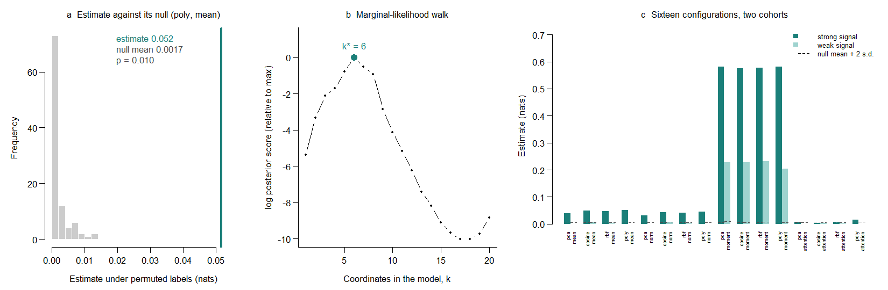
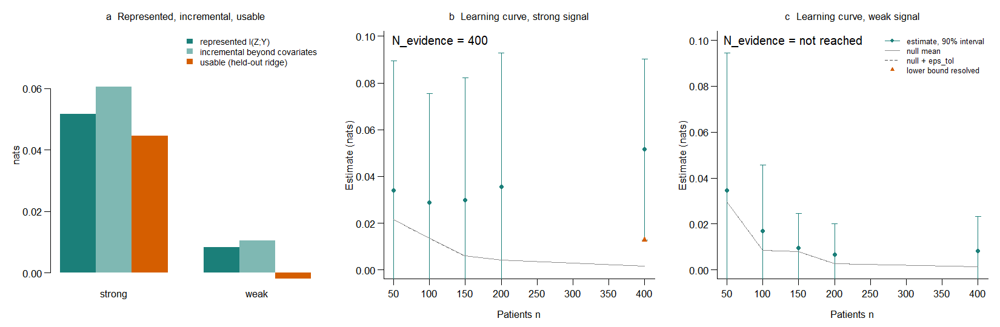
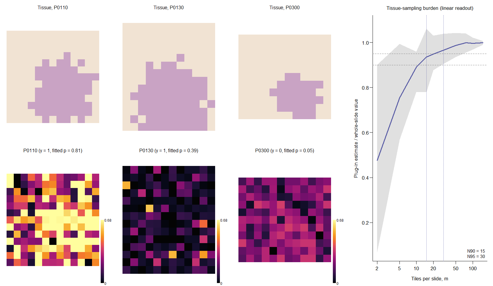
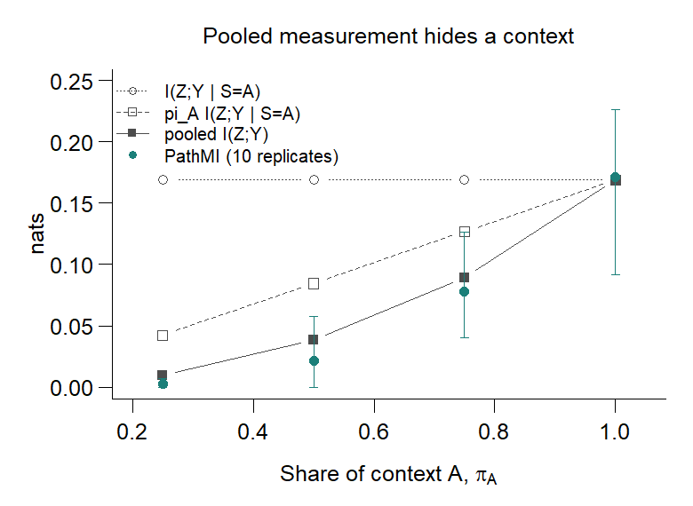

# PathMI

PathMI measures **molecular recoverability**: how much information a pathology foundation model's embedding of a patient's slides carries about a binary molecular state, such as microsatellite instability or an ERG fusion. The estimate is a mutual information in nats. It is built for a few hundred patients and many more embedding coordinates than patients.

Molecular recoverability is a property of the evaluated representation and target (the model, pooling rule, projection and readout together), not of the foundation model in isolation. Around the estimator, the package provides what is needed to report an estimate as a measurement:

- a permutation null, with max-T tests when a representation is selected from several;
- an empirical numerical tolerance and patient-level uncertainty;
- what the representation adds over measured covariates;
- what a patient-held-out readout can use;
- how many patients and how much tissue a measurement needs;
- a Recoverability Record that holds all of this with its provenance, its evidence status and the interpretations it supports.

This repository accompanies the manuscript *Measuring molecular recoverability in pathology foundation models* (Bhadury, Kulkarni and Rao, 2026). The worked example below runs on simulated data; the section [Reproducing the manuscript](#reproducing-the-manuscript) gives the code for every analysis of the paper. The embeddings used in the study are not distributed with this repository.

## Installation

```r
# install.packages("remotes")
remotes::install_github("sagnikbhadury/PathMI")
```

Imports `glmnet`, `MASS` and `BayesLogit`; `jsonlite` is needed to write Records as JSON. Developed with R 4.4.3. Version 0.3.0 matches the submitted manuscript; see [`NEWS.md`](NEWS.md).

## The estimator in brief

Take a representation **Z** (n patients by p coordinates) and a binary label y. PathMI then works in four steps:

1. **Ranking.** A logistic regression with the horseshoe prior is sampled by Gibbs under Pólya–Gamma augmentation. The coordinates are ordered by the absolute posterior median of their coefficients.
2. **Walk.** The nested models M₁ ⊂ … ⊂ M_K are scored by their Laplace marginal likelihood under a Gaussian working prior, plus the log Beta-Bernoulli probability of the subset (with a = b = 1 this is 1/[(p+1) C(p,k)], a uniform prior on the size k). M_k holds the intercept and the k highest-ranked coordinates, with K = min(p, n − 1). The selected size k\* maximises the score over the ranked candidate sizes.
3. **Estimate.** Î(Z;Y) = [log p(y | M_k\*) − log p(y | M₀)] / n, floored at zero. This is the log Bayes factor per patient.
4. **Null.** Steps 1–3 are refitted on permuted labels.

PathMI is an operational estimator of recoverability within a specified representation and working model family. It is conservative in many simulation settings, but it is not guaranteed to be a lower bound on population mutual information in finite samples. The nested-model walk carries over a step-up selection principle introduced for Gaussian graphical models (Bhadury, Mitra and Gaskins, 2023, arXiv:2308.02713), which is why the engine functions carry the `subho` prefix.

## A worked example

[`tools/readme_figures.R`](tools/readme_figures.R) reproduces every number and figure in this section, and [`tools/readme_numbers.txt`](tools/readme_numbers.txt) holds its output. `Rscript tools/readme_figures.R 20` takes about 12 minutes on 20 cores. The design follows the paper: four pooling rules and four projections, sixteen configurations per cohort.

### 1. Simulate slides, pool them per patient, project

`simulate_cohort()` draws slides as grids of tile embeddings. Each slide has a contiguous tumour region whose share varies, as purity does. In patients with the state, the tumour tiles are shifted along a few directions, so the state leaves a trace in part of the tissue only. Each patient also carries a covariate correlated with the state, standing in for stage. We simulate two cohorts of 400 patients, one with a strong trace and one with a weak trace; each has about 460 slides, because some patients have several.

```r
library(PathMI)
sim <- simulate_cohort(400, prevalence = 0.3, D = 64, tiles_mean = 150,
                       effect = 0.45, tile_sd = 0.4, p_multi = 0.08, seed = 11)

POOLS   <- c("mean", "norm", "moment", "attention")
DECOMPS <- c("pca", "cosine", "rbf", "poly")
Xs <- lapply(setNames(POOLS, POOLS), function(pl) pool_cohort(sim$tiles, sim$patient, pl))
y  <- sim$y[rownames(Xs$mean)]
keys <- as.vector(outer(DECOMPS, POOLS, paste, sep = "_"))       # "pca_mean", ...
Zs <- lapply(setNames(keys, keys), function(k)
  project_embeddings(Xs[[sub(".*_", "", k)]], sub("_.*", "", k), d = 20))
```

The unit is the patient. `pool_cohort()` pools each slide and then averages a patient's slides. Treating sibling slides as separate observations would count the same patient's evidence twice in the marginal likelihood, and would leak information between folds when the data are cross-fitted. The `"attention"` rule is untrained random attention (weights drawn once and never fitted); it is a label-free sensitivity arm and does not test trained attention pooling. `fit_projection()` and `apply_projection()` separate fitting from projecting, so that held-out patients can be projected with a training fit (the out-of-sample extension of kernel PCA).

### 2. Estimate, null, and selection over configurations

```r
fits  <- lapply(Zs, pathmi_fit, y = y)
perms <- draw_permutations(length(y), B = 100)       # one matrix shared by all 16
nulls <- Map(function(Z, f) pathmi_null(Z, y, perms, observed = f, cores = 20), Zs, fits)

sel4  <- select_representation(nulls[paste(DECOMPS, "mean", sep = "_")])  # 4 projections
sel16 <- select_representation(nulls)                                     # all 16: p_max16
verify_permutation_alignment(nulls[1:2], Zs, y, b = c(1, 37))  # stored permuted fits refit exactly
```

<p align="center"></p>

**a.** In the strong cohort, the cubic-kernel projection of the mean-pooled slides gives 0.052 nats. The null from 100 permutations has mean 0.0017, and no permuted estimate reaches the observed one (p = 0.010, the floor for 100 permutations).

**b.** The walk peaks at k\* = 6 coordinates and falls on either side.

**c.** The sixteen configurations of both cohorts. Under mean, norm-weighted and untrained random attention pooling the strong cohort gives 0.004 to 0.052 nats and the weak cohort at most 0.008; the best mean-pooling arm of the weak cohort (cosine kernel, 0.008 nats) has a max-T p of 0.059 over its four projections. Moment pooling stands apart (0.58 nats in the strong cohort and 0.23 in the weak one, from one to nine coordinates). In this simulator the shift of the positive tumour tiles also changes the tumour–stroma contrast of every positive slide, so the within-slide standard deviation that moment pooling adds to the mean is nearly a label. This is a property of the simulated mechanism, and the rest of the example follows the mean-pooling arm, whose tile decomposition is exact (section 6). Over all sixteen configurations p_max16 = 0.010 in both cohorts, and refitting stored permuted fits reproduced them exactly.

`select_representation()` takes the largest estimate and tests it against the maximum over all candidates under each permutation. This is valid only when every candidate was refitted on the same permuted labels; the function stops otherwise, and `verify_permutation_alignment()` confirms it by refitting stored permuted fits. The test adjusts detection within the set of candidates. It does not adjust across separate sets (for example, across models or states), and it does not correct the magnitude of the selected estimate.

### 3. Numerical tolerance and uncertainty

Two refits should return the original estimate: a refit with an independent random-number stream, and a refit of an equivalent representation with the signs of every other coordinate flipped. The largest discrepancy is the empirical numerical tolerance ε_tol, and contrasts are reported in units of it. A refit after appending columns that carry no information changes the model, so it is a specification check and is reported outside the tolerance. Patient-level uncertainty comes from refitting on random halves of the patients, with the delete-d jackknife standard error (Shao and Wu, 1989).

```r
mk  <- paste(DECOMPS, "mean", sep = "_")
tol <- numerical_tolerance(
  replicate     = sapply(mk, function(k) replicate_refit(Zs[[k]], y, fits[[k]])),
  sign_flip     = sapply(mk, function(k) sign_flip_refit(Zs[[k]], y, fits[[k]])),
  specification = sapply(mk, function(k) null_block_refit(Zs[[k]], y, fits[[k]])))
key <- sel4$selected                    # the recorded arm: mean pooling (see section 2)
hs  <- half_sampling(Zs[[key]], y, B = 100, cores = 20)
```

In both simulated cohorts the replicate and sign-flip refits reproduced the estimates exactly, so ε_tol = 0. The null-block specification check moved the estimate by at most 0.0040 nats (5 of 8 arms unchanged). On real embeddings the refits do differ: in the paper, Monte Carlo variation of the ranking near ties gave ε_tol = 0.0163 nats for three vision-only models and 0.0215 for CONCH v1.5. For the strong cohort, the half-sampling standard error is 0.024 and the 90 % interval runs from 0.013 to 0.090.

The tolerance is empirical and protocol-specific. It is not a universal error bound and does not cover fits that are unstable across chain seeds, which should be flagged separately (in the paper, one CONCH v1.5 configuration moved from 0.032 to 0.104 nats across seeds). We do not use the bootstrap with replacement: a patient drawn twice counts twice in the marginal likelihood, and the estimate is biased upward.

### 4. Represented, incremental and usable recoverability

- **Represented:** the information the embedding carries, I(Z;Y), estimated by PathMI.
- **Incremental beyond measured covariates:** the gain from adding the embedding to the covariates. It is a model-based difference of two PathMI estimates, an empirical counterpart of I(Z;Y | C); it does not establish causal attribution or exclude unmeasured confounding.
- **Usable:** what a readout fitted on other patients achieves, measured as the held-out log-likelihood gain (Xu et al., 2020).

```r
pl <- sub(".*_", "", key); dc <- sub("_.*", "", key)
n_tiles <- tapply(sapply(sim$tiles, nrow), sim$patient, sum)[rownames(Xs[[pl]])]
C   <- cbind(stage = scale(sim$covariate[rownames(Xs[[pl]])]), log_tiles = scale(log(n_tiles)))
inc <- incremental_recoverability(Zs[[key]], C, y)
use <- usable_recoverability(Xs[[pl]], y, decomp = dc, d = 20, K = 5, R = 5)
```

`usable_recoverability()` fits the standardisation, the projection and the readout inside the training patients of each fold; supplying `group =` keeps all rows of a patient in one fold. The population bound usable ≤ represented uses the true marginal; the cross-fitted estimate uses the training prevalence and need not respect it.

<p align="center"></p>

**a.** Strong cohort: represented 0.052 nats; incremental beyond the covariates 0.061 (covariates alone 0.078, combined 0.138); usable by a held-out ridge readout 0.045 (AUC 0.68). Weak cohort: represented 0.008, incremental 0.011 and usable −0.002 (AUC 0.51).

### 5. The smallest sample size that satisfies the resolution criterion

`learning_curve()` refits the projection and the estimator on label-stratified subsamples of n patients. At each n it also fits a null on permuted labels and a held-out usable readout. A measurement is **resolved** at n when the lower 90 % bound exceeds the null mean plus ε_tol, and N_evidence is the smallest evaluated n that satisfies this operational criterion. It is a classification of evidence sufficiency under the protocol, not a calibrated confidence procedure. The standard error of a study of n patients is the spread of the subsample estimates divided by (1 − n/N)^½; at n = N/2 this factor is √2, whereas the jackknife factor of the full-cohort standard error is 1, because the two describe studies of N/2 and of N patients.

```r
lc <- learning_curve(Xs[[pl]], y, dc, 20, n_grid = c(50, 100, 150, 200), B = 40,
                     eps_tol = tol$tolerance, cores = 20,
                     full = list(estimate = fits[[key]]$estimate, se = hs$se,
                                 null_mean = nulls[[key]]$mean))
attr(lc, "N_evidence")
```

**b.** In the strong cohort, the estimate stays above the null at every size, but its lower bound clears the threshold only at the full cohort: N_evidence = 400, the largest evaluated sample size.

**c.** In the weak cohort, the estimate follows the null and is never resolved.

An unresolved Record means insufficient evidence under this representation, patient budget and protocol. It is not evidence that the state leaves no trace in the tissue. A rising usable curve under an unresolved estimate suggests that more patients may help, and a flat low one suggests low recoverability under the representation; neither proves it.

### 6. Model-associated evidence on the slide, and the tissue a readout needs

Under mean pooling with linear PCA, a patient's fitted logit is an affine function of the mean of its tile embeddings, so the fitted linear logit decomposes exactly into tile contributions. `tile_decomposition()` returns each tile's contribution and its **specific surprise**: the KL divergence between the tile's as-if prediction and the prevalence (DeWeese and Meister, 1999). The maps come from the in-sample fitted readout. Specific surprise measures how far a tile moves the fitted belief, in either direction; it is not an independently validated local molecular state.

`tissue_burden()` recomputes the logit from m random tiles per slide and reports N90 and N95, the tiles needed to retain 90 and 95 % of the fixed linear readout's whole-slide in-sample plug-in log-score gain.

```r
td <- tile_decomposition(sim$tiles, sim$patient, sim$y, d = 20)
plot_tile_map(td, slide = 1, coords = sim$coords[[1]])
bd <- tissue_burden(td)
```

<p align="center"></p>

The top row shows the simulated tissue, with tumour in purple; the bottom row shows the specific surprise of each tile (tile contributions reproduce the patient logits to 1.3 × 10⁻¹⁵).

- In the confidently called positive patient (P0110, fitted p = 0.81), the high-surprise tiles sit on the tumour region.
- In the positive patient called near the prevalence (P0130, p = 0.39), most tiles carry little evidence; its tumour trace is weaker than the noise in its tiles.
- The negative patient (P0300) shows moderate surprise everywhere, in the direction of the negative state.

Right: the fixed linear readout retains 90 % of its whole-slide log-score gain with 15 tiles per slide and 95 % with 30. With two tiles per slide it retains about half; the band is the 5 to 95 % range over the random tile draws.

### 7. The Recoverability Record

```r
rec <- recoverability_record(
  provenance = list(model = "simulated encoder (D = 64)", pooling = pl, projection = dc, d = 20, unit = "patient"),
  fit = fits[[key]], null = nulls[[key]], uncertainty = hs, eps_tol = tol$tolerance,
  incremental = inc, usable = use, burden = bd, curve = lc, selection = sel4)
rec
#> Recoverability Record
#>   represented    0.0516 nats (8% of H(Y) = 0.631), k* = 6, n = 400
#>   null           0.0017 +/- 0.0029 (p = 0.010; max over 4 configs p = 0.010) | eps_tol 0.0000
#>   90% interval   0.0128 to 0.0903 (s.e. 0.0236)
#>   incremental    0.0605 (beyond covariates)
#>   usable         0.0445 (AUC 0.68)
#>   tiles N90/N95  15 / 30
#>   status         resolved (N_evidence 400)
record_to_json(rec, "record.json")
```

Each JSON Record (schema 1.1) also carries protocol notes, the resolution margin, and two lists populated from the evidence status: `supported_interpretations` (for example, above-null recoverability under the stated protocol) and `interpretations_not_established` (external generalizability, spatial molecular fidelity, causal mechanism, clinical utility, absence of residual confounding, independence from pretraining data, a lower bound on population mutual information, subgroup recoverability). The simulated Records are in [`tools/`](tools); the twelve Records of the study and its negative control are in [`results/record`](results/record).

### 8. A pooled estimate can hide a context

Suppose a cohort mixes a context A, where the representation predicts the state, with a context B, where it does not, and the estimator cannot see the context. If the context S is independent of Z, then I(Z;Y) ≤ I(Z;Y | S) = π_A I(Z;Y | S = A). `simulate_hidden_context()` builds this design with Monte Carlo truths.

<p align="center"></p>

The information within context A stays at 0.169 nats. As the share of context A, π_A, falls from 1 to 0.25, the pooled information falls to 0.0095 and the PathMI estimate (mean of 10 replicates) follows it, from 0.171 to 0.003. A small pooled estimate is therefore compatible with a subgroup in which the state is well recovered. A measurement qualified in a pooled population does not automatically qualify inference in a constituent subgroup.

## Reproducing the manuscript

The study used Trident features of the TCGA colorectal (COAD + READ; MSI) and prostate (PRAD; ERG and ETS fusion) slides under UNI v2, Virchow2, H-optimus-1 and CONCH v1.5, at 20X. The features are not redistributed. Each analysis below is given as package code that runs on any features in the same layout, with the study script that produced the paper's numbers ([`study/`](study), run as is on the original paths) and the deposited output ([`results/`](results)). Numbers quoted in brackets are those of the paper.

### Inputs and the 16 representations

For one cohort and model you need a list of tile-embedding matrices (one per slide), the patient of each slide, a 0/1 label per patient and, for the covariate analyses, a covariate matrix per patient.

```r
library(PathMI)
POOLS   <- c("mean", "norm", "moment", "attention")
DECOMPS <- c("pca", "cosine", "rbf", "poly")
Xs   <- lapply(setNames(POOLS, POOLS), function(pl) pool_cohort(tiles, patient, pl))
y    <- labels[rownames(Xs$mean)]                       # one row per patient
keys <- as.vector(outer(DECOMPS, POOLS, paste, sep = "_"))
Zs   <- lapply(setNames(keys, keys), function(k)
  project_embeddings(Xs[[sub(".*_", "", k)]], sub("_.*", "", k), d = 50))
sapply(Zs, attr, "condition")                           # condition number of the retained spectrum
```

Study: `pool_pass.R`, `projection_functions.R`, `patient_level/pl_grid.R`. A slide entered if its patient had a label and it had at least 100 tiles under the model; a patient's slides are averaged (693 patients, 727 slides).

### 1. The 192-cell grid with permutation nulls (Table 1, Fig. 2a)

```r
fits  <- lapply(Zs, pathmi_fit, y = y)                  # v_beta = 1, 2000 iterations, 500 burn-in, thin 10, seed 42
perms <- draw_permutations(length(y), B = 200)          # drawn once per cohort and model
nulls <- Map(function(Z, f) pathmi_null(Z, y, perms, observed = f, cores = 24), Zs, fits)
sapply(nulls, `[[`, "p_value")                          # individual permutation p values (nominal)
```

Study: `patient_level/pl_grid.R` (all 8 cohort-model runs, 38,592 fits). Results: `results/grid/mi_summary_table.xlsx`, `results/per_run/`. [171 of 192 configurations exceed their individual nulls at nominal p < 0.05; largest estimates 0.118, 0.084 and 0.150 nats for MSI, ERG and ETS.] The same permutation matrix serves both prostate states.

### 2. Selection: four projections per pooling, sixteen configurations per model and state (Table 2)

```r
sel4  <- lapply(setNames(POOLS, POOLS), function(pl) select_representation(nulls[paste(DECOMPS, pl, sep = "_")]))
sel16 <- select_representation(nulls)                   # the recorded configuration and p_max16
verify_permutation_alignment(nulls[c(sel16$selected, keys[1])], Zs, y, b = c(1, 137))
```

Study: `patient_level/pl_grid.R` (four-projection max-T), `patient_level/max16.R` (p_max16 and the alignment checks; `Rscript ... refit` adds 48 exact refits). Results: `results/grid/best_kpca_summary.xlsx`, `results/max16/`. [p_max16 = 0.005 for ten pairs, 0.015 for Virchow2/ERG, 0.040 for CONCH v1.5/ERG.]

### 3. Comparing models across the grid (Fig. 2b, Supplementary Tables 1–3)

These are descriptive summaries of the evaluated grid: configurations reuse patients and rosters differ between models, so they are not independent replications or population rankings. With `g` a data frame of the 192 estimates (`state`, `model`, `decomp`, `pooling`, `MI`):

```r
g$block <- interaction(g$state, g$decomp, g$pooling)
friedman.test(MI ~ model | block, data = g)                          # mean ranks over 48 blocks
w <- reshape(g[, c("block", "model", "MI")], idvar = "block", timevar = "model", direction = "wide")
p.adjust(c(wilcox.test(w$`MI.H-optimus-1`, w$`MI.UNI v2`, paired = TRUE)$p.value), "holm")
anova(lm(MI ~ (state + model + decomp + pooling)^2, data = g))       # interactions on the grid
```

Study: `config_comparison_tests.R`, `results_four_backbones_numbers.R`, `figures_four_backbones.R`, `tables_main.R`.

### 4. Incremental recoverability beyond measured covariates (Fig. 3b, Supplementary Tables 4–5)

```r
C_crc  <- cbind(log_tile_count = scale(log1p(n_tiles)), stage = scale(ajcc_stage_ordinal))
inc    <- incremental_recoverability(Zs[[sel16$selected]], C_crc, y)
# prostate: size + Gleason sum, then + ABSOLUTE purity and scanning-batch indicators
```

Study: `patient_level/pl_incremental.R`, `prad_incremental_batch_purity.R`. Results: `results/grid/incremental_mi_summary.xlsx`, `results/prad_batch_purity/`. [Size and stage carry 9–11 % of the colorectal estimate under the vision-only models; size, Gleason, purity and batch leave 97–100 % of the fusion estimates.]

### 5. Numerical tolerance and tolerance units (Fig. 3c, Supplementary Table 7)

```r
tol <- numerical_tolerance(replicate = rep_d, sign_flip = flip_d, specification = null_block_d)
# per model group; contrasts are reported as Delta / tol$tolerance and Delta / s.e.
```

In the study the replicate refit is the embedding-only fit of the incremental analysis (an independent random-number stream, 48 selected arms) and the sign-flip refit recomputes the projection with an independent routine (192 cells). Study: `tolerance.R`, `resolution_units.R`, `resolution_table.R`. Results: `results/robustness/tolerance*.csv`, `results/robustness/resolution_units.csv`. [ε_tol = 0.0163 nats for the vision-only models, 0.0215 for CONCH v1.5; null covariate block reported separately, 0.012 nats in 1 of 32 arms.]

### 6. Tile-level decomposition and model-associated evidence maps (Figs. 4–5)

```r
td <- tile_decomposition(tiles, patient, labels, d = 50)   # mean pooling, linear PCA: exact
td$max_identity_error                                      # tile means reproduce the patient logits
plot_tile_map(td, slide = 1, coords = tile_coords[[1]])
```

A tile is high-surprise when the lower 5 % posterior quantile of its specific surprise exceeds the arm's null mean plus two s.d. Study: `tile_maps_hoptimus1.R`, `figures_tile_maps.R`. Results: `results/tile_maps/`.

### 7. Usable recoverability with every transformation in the training patients (Fig. 6a, Supplementary Table 8)

```r
use <- lapply(keys, function(k) usable_recoverability(Xs[[sub(".*_", "", k)]], y, sub("_.*", "", k), d = 50,
                                                     K = 5, R = 10, readout = c("ridge", "pathmi"), group = NULL))
```

Study: `usable_infold.R`, `infold_functions.R`, `usable_infold_stats.R` (and `usable_recoverability.R` for the fixed-projection comparison). Results: `results/usable/`. [r = 0.85 with the estimate; in-fold and fixed projections differ by a median of +0.002 nats.]

### 8. Robustness: retained dimension, working prior, chain seeds, size prior (Fig. 6b–c, Supplementary Tables 9–10)

```r
for (d in c(10, 20, 30, 50, 75, 100)) pathmi_fit(project_embeddings(X, "cosine", d), y)
for (v in c(0.1, 0.3, 1, 3, 10, 30, 100)) pathmi_fit(Z, y, v_beta = v)
for (s in 1:5) pathmi_fit(Z, y, seed = 41 + s)
subho_MI_logistic(Z, y, method.weight = "basic.binomial")
```

Each sweep point was read against 100 permutations of its own setting. Study: `robustness_dimension.R`, `robustness_prior_bootstrap.R`, `robustness_tables.R`. Results: `results/robustness/{dimension,vbeta}_sweep*.csv`, `chain_sizeprior.csv`.

### 9. Patient-level uncertainty (Fig. 6d, Supplementary Table 11)

```r
hs <- half_sampling(Z, y, B = 200, cores = 24)   # s.e. = sd x sqrt(m / (n - m)), m = floor(n/2)
```

Study: `robustness_subsampling.R`, `subsampling_table.R` (the with-replacement bootstrap is kept only to show its upward bias, a median +0.045 nats). Results: `results/robustness/subsampling_*.csv`, `bootstrap_*.csv`.

### 10. Tissue-sampling burden of the fixed linear readout (Fig. 6e, Supplementary Table 12, Supplementary Fig. 1)

```r
bd <- tissue_burden(td, m_grid = c(5, 10, 15, 20, 25, 30, 40, 50, 75, 100, 150, 200, 300, 500, 1000, 2500), R = 20)
bd$N                                             # N90 and N95, tiles per slide
```

Study: `sampling_burden_all_models.R`, `burden_ordering_bootstrap.R`, `burden_table.R`. Results: `results/burden/`.

### 11. Learning curves, evidence status and the negative control (Fig. 7a–c)

```r
lc <- learning_curve(Xs[[pl]], y, dc, 50, n_grid = c(50, 100, 150, 200, floor(length(y) / 2)), B = 50,
                     eps_tol = tol$tolerance, full = list(estimate = fits[[key]]$estimate, se = hs$se,
                                                          null_mean = nulls[[key]]$mean))
set.seed(20261119); y_ctl <- sample(y)            # negative control: labels permuted once
```

Study: `learning_curves.R`, `learning_summary.R`, `status_recheck.R` (re-derives every status, margin and N_evidence from the raw draws). Results: `results/learning/`, `results/record/status_recheck.*`. [Nine of twelve Records resolved, each only at its full cohort; the three ERG records of UNI v2, Virchow2 and CONCH v1.5 and the control are unresolved.]

### 12. The Recoverability Record (Table 2)

```r
rec <- recoverability_record(provenance, fits[[key]], nulls[[key]], hs, tol$tolerance,
                             incremental = inc, usable = use_key, burden = bd, curve = lc, selection = sel16)
record_to_json(rec, "record.json")
```

Study: `recoverability_record.R` (CSV, JSON and the LaTeX table). Results: `results/record/`.

### 13. Hidden-context simulation (Fig. 7d)

```r
s <- simulate_hidden_context(400, pi_A = 0.5, seed = 1)      # truth by Monte Carlo
pathmi_fit(s$Z, s$y); pathmi_fit(s$Z[s$context == "A", ], s$y[s$context == "A"])
```

Study: `hidden_context_sim.R`, `figures_learning_context.R` (50 cohorts of 400 at π_A = 0.25, 0.5, 0.75; detection above the null mean plus two s.d.). Results: `results/simulation_context/`.

### 14. Estimator comparison by simulation (Supplementary Figs. 2–8)

```r
s <- simulate_estimator_design(n = 200, p = 500, s = 5, beta = 0.7, seed = 1)
c(PathMI = pathmi_fit(s$Z, s$y)$estimate,
  LASSO  = compute_doe_mi(s$Z, s$y, run_lasso_cv(s$Z, s$y))$MI,
  DV_linear = doe_linear(s$Z, s$y)$estimate, truth = s$truth)
```

The design crosses n ∈ {100, 200, 500}, p ∈ {50, 200, 500}, s ∈ {5, 20, 50} and β ∈ {0.3, 0.7, 1.5} (72 cells, 50 replicates). Study: `estimator/simulation_MI_comparison.R`, `estimator/run_simulation.R`. Results: `results/simulation_estimators/`.

### Running the study chain

On the original data the full analysis is two shell chains, run from the project root with R 4.4.3: `study/patient_level/run_patient_chain.sh` (the 30-step patient-level analysis) and `study/patient_level/run_final_edits_chain.sh` (tolerance, Record, status checks and figures), after `Rscript study/patient_level/max16.R refit`. Paths to the Trident features and pooled matrices are set at the top of each script.

## Functions

| Step | Functions |
|---|---|
| Representation | `pool_tiles()`, `pool_cohort()`, `fit_projection()`, `apply_projection()`, `project_embeddings()` |
| Estimate | `pathmi_fit()`; engine `subho_MI_logistic()`, `selection.logistic()` |
| Null and selection | `draw_permutations()`, `pathmi_null()`, `select_representation()`, `verify_permutation_alignment()` |
| Tolerance and uncertainty | `replicate_refit()`, `sign_flip_refit()`, `null_block_refit()`, `numerical_tolerance()`, `half_sampling()` |
| Counterparts | `incremental_recoverability()`, `usable_recoverability()` |
| Evidence | `learning_curve()`, `evidence_status()` |
| Tiles | `tile_decomposition()`, `tissue_burden()` |
| Record | `recoverability_record()`, `record_to_json()` |
| Plots | `plot_null()`, `plot_walk()`, `plot_learning_curve()`, `plot_tile_map()`, `plot_burden()` |
| Simulation | `simulate_cohort()`, `simulate_hidden_context()`, `simulate_estimator_design()` |
| Comparison estimators | `doe_linear()` (Donsker–Varadhan bound, linear critic), `run_lasso_cv()` + `compute_doe_mi()`, `compute_ols_mi()`, `run_PathMI_LASSO()`, `run_PathMI_OLS()` |
| Earlier interface | `pathMI_pipeline()`, `permutation_test_logistic()`, `plot_MI_null()`, `plot_likelihood_surface()`, `v_beta_sensitivity()`, `reproducibility_bound()` (deprecated) |

Every function has a help page (`?pathmi_fit`, `?select_representation`, …). The sampler is silent by default; `options(PathMI.verbose = TRUE)` prints its progress.

## Repository layout

| Path | Content |
|---|---|
| `R/`, `man/`, `tests/` | The package and its tests. |
| `tools/` | The script that produces the README figures, and its outputs (numbers, simulated Records as JSON). |
| `results/` | Patient-level result tables of the study: the 192-cell grid, max-16 tests, Records, tolerance, usable recoverability, learning curves, robustness, burden, tile summaries and simulations. It holds no embeddings. See [`results/README.md`](results/README.md). |
| `study/` | The scripts that produced the manuscript's analyses, as run. They read Trident features that are not distributed here. See [`study/README.md`](study/README.md). |

## Data

Whole-slide images and molecular annotations for TCGA COAD, READ and PRAD are available from the Genomic Data Commons (https://portal.gdc.cancer.gov). The study's tile embeddings were extracted with Trident from the public UNI v2, Virchow2, H-optimus-1 and CONCH v1.5 weights. They are not redistributed here and can be regenerated under each model's licence. Some of these models may have been pretrained on TCGA slides; patient-held-out readouts do not establish independence from pretraining.

## License

MIT; see [`LICENSE.md`](LICENSE.md).
